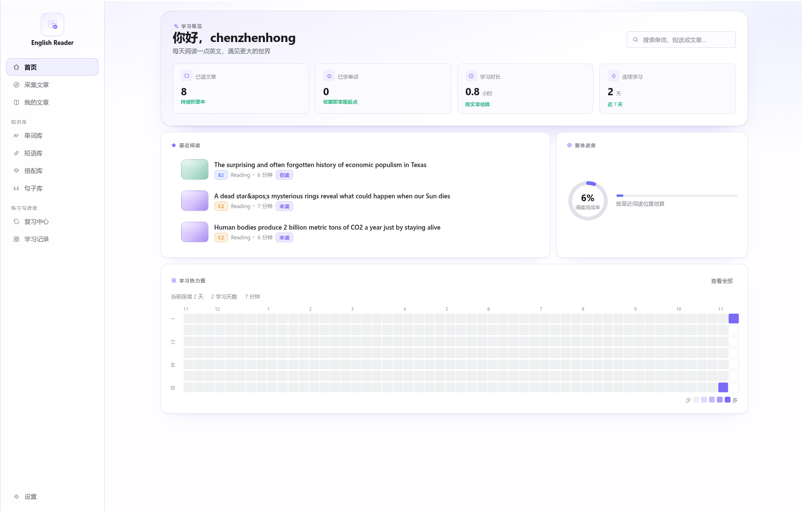
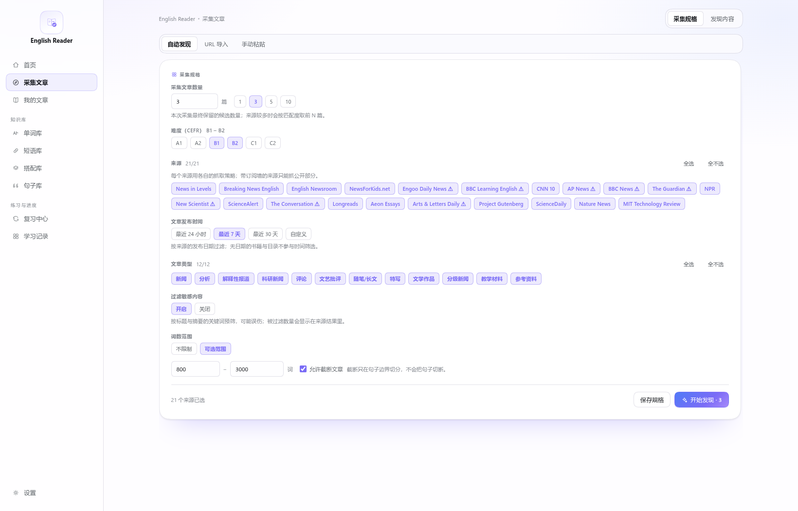
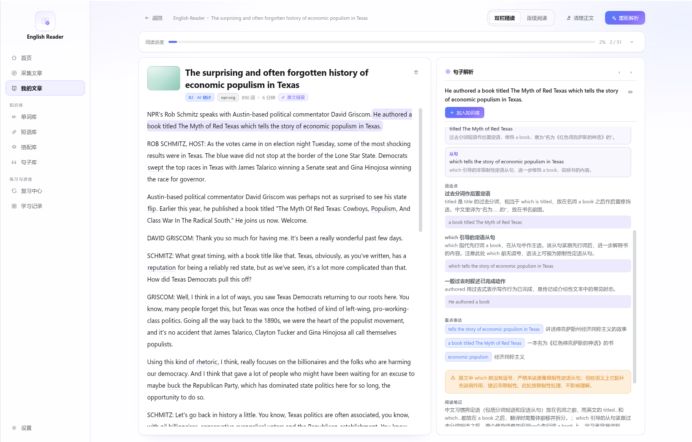
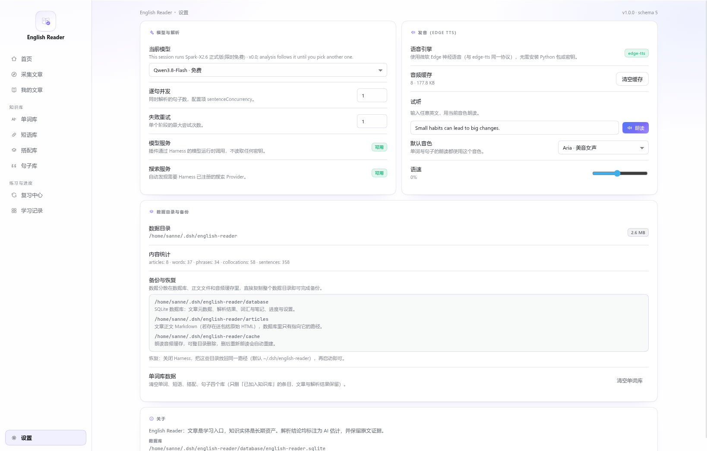

# English Reader

一个以文章为入口的 AI 英语阅读插件，作为 DeepSeek Harness 的原生 bundle 运行：自动发现 / URL 导入 / 手动粘贴 → 正文清洗与去重 → 分阶段 AI 解析（导读、难度、单词、短语、搭配、切分、逐句、复盘）→ 连续阅读与双栏精读 → 跨文章复用的个人知识库与复习队列。

所有数据本地优先：SQLite（`node:sqlite`）+ 每篇文章的正文文件。模型调用经 Harness 的 `llm` 运行时，插件不读取任何 API Key。

## 安装

```bash
# 在 dsh 会话中
plugin_manager  install_bundle   target: /absolute/path/to/english-reader
```

或在插件管理界面里安装目录。安装后侧栏出现 `English Reader` 图标，点击进入主面板。

## 配置（`cordis.patch.yml`）

| 键 | 默认 | 说明 |
|---|---|---|
| `dataDir` | `$DSH_HOME/english-reader` | 数据库与文章正文目录；留空用默认 |
| `sentenceConcurrency` | `2` | 逐句解析并发（1–5） |
| `retryLimit` | `2` | 单个阶段最大尝试次数 |
| `wordsPerArticle` | `15` | 每篇提取的重点词数 |

## 界面

| 页面 | 说明 |
|---|---|
| 首页 | 学习统计、最近阅读、学习热力图 |
| 采集文章 | 两级页签：**采集规格**（自动发现 / URL 导入 / 手动粘贴）与**发现内容**（候选列表，滚到底自动加载下一页）。规格含难度区间 / 21 个来源 / 发布时间 / 12 种类型 / 敏感内容 / 词数 |
| 我的文章 | 搜索与筛选（难度、状态、来源），解析、阅读、删除。列表撑满一屏，内部滚动 |
| 文章详情 | 双栏精读（左原文右解析）与连续阅读；句子联动、单词弹窗（可「加入单词库」）、笔记、解析进度、「清理正文」重新抓取并只留正文 |
| 知识库 | 单词 / 短语 / 搭配 / 句子四个库，收藏、掌握程度、来源语境 |
| 复习中心 | 未掌握单词的卡片式复习 |
| 设置 | 模型（按 Harness 分组，显示会话实际使用的模型）、解析参数、发音（音色 / 语速 / 试听 / 缓存）、数据目录与备份说明 |

## 界面预览

<table>
<tr>
<td></td>
<td></td>
</tr>
<tr>
<td></td>
<td></td>
</tr>
</table>

## Agent 工具

| 工具 | 用途 |
|---|---|
| `english_reader_search` | 搜索文章或任一知识库集合 |
| `english_reader_import` | 按 URL 或正文导入，可选立即解析 |
| `english_reader_analyze` | 启动 / 查询 / 重试单个阶段 / 取消解析 |
| `english_reader_knowledge` | 收藏、设置掌握程度、写笔记 |
| `english_reader_speak` | 用 Edge 神经语音朗读单词 / 短语 / 整句（返回 MP3 附件） |

UI 与工具调用同一个 facade，行为一致。

## 视觉

界面按 [Bento Grid 2.0 规范](docs/bento-grid-2.0.md) 排版：12 列 board，单元格按内容价值取 span，全 board 只有一个 gap 值，圆角随面积增大，阴影最多两层。规范按 **[measured] / [derived] / [constraint]** 标注每条规则的来源。`tests/bento.mjs` 把规范变成断言。

## 学习记录

GitHub 风格热力图展示**最近一年**的真实学习情况，颜色深浅按当天学习时长分四档。首页嵌的是同一个组件。

统计依据是**真实记录的学习事件**（保存进度、复习单词、加入知识库），不使用文章预估阅读时长。

## 知识库

解析文章只产生**候选**（词汇、短语、搭配、句子），不会自动进入知识库。只有你主动点「加入知识库」的条目才出现在列表里。

加入入口在阅读页四处：重点单词卡右上角、短语行右侧、搭配行右侧、逐句面板句子上方。再次点击可移出。复习中心只覆盖已加入的词汇。

## 采集规格与来源策略

采集规格含七项：采集数量、CEFR 区间、来源多选（21 个）、发布时间、文章类型（12 种）、敏感内容过滤、词数。候选列表分页读取，滚到底自动加载下一页。勾选后可导入所选或删除勾选。

每个来源一套抓取策略（feed / html / catalog），定义在 `lib/sources.js` 注册表里。**新增来源只需追加一行**，不必改采集流程。失败来源会标 ⚠ 并记住原因，不会把抓取失败说成「没有文章」。

## 正文清理

出版商页面大半是页面装饰：无障碍链接、作者行、分享按钮、版权声明、赞助位。插件在导入时自动剔除这些内容，只保留正文段落。清理器**与站点无关**，不维护选择器表，站点改版也能用。

文章详情页的「清理正文」可重新抓取原文并重建句子——但正文变了，旧分析会被清除，需要重新解析。实现细节见 `lib/clean.js`。

## 解析失败

文章详情页的阶段条会标记失败阶段，点击可查看错误码、原因和模型原始输出。失败句子可单独重试，不影响其他已成功的结果。

错误码：`LLM_TRUNCATED`（输出被截断）、`LLM_INVALID_JSON`（JSON 不合法）、`LLM_UNAVAILABLE`、`LLM_TIMEOUT`、`SCHEMA_VALIDATION_FAILED`、`EVIDENCE_NOT_FOUND`。

## 抓取与网络

抓取优先走 Harness 自己的网络通道（`ctx.web.fetch()`）：它认识部署的 fake-IP 段，所以站在代理后面的环境里也能拿到页面；插件自带的抓取器留作兜底，并自带 SSRF 防护（拒绝内网、回环与云元数据地址，仅放行部署显式声明的合成段）。

> 若目标站正文很长，注意 Harness 抓取 provider 的 `maxBodyChars` 默认 100000 字符——页面框架就可能超限，正文会被截断。`cordis.patch.yml` 里调大它即可：
> ```yaml
> - id: web-fetch-http
>   name: "@deepseek-ai/dsh-web-fetch-http"
>   config:
>     maxBodyChars: 3000000
>     maxResponseBytes: 6000000
> ```

## 数据与备份

数据分三处：SQLite（`node:sqlite`，元数据 / 解析 / 词汇 / 进度）、`<dataDir>/articles/<id>/cleaned.md`（正文）、`<dataDir>/cache/speech/`（音频缓存）。备份就是**整个 `<dataDir>` 目录**拷走；恢复时放回同一路径再启动 Harness 即可。设置页「数据目录与备份」里列出了需要复制的子目录。

## 发音（edge-tts）

朗读走微软 Edge 的神经语音接口，与 `edge-tts` **同一套 WebSocket 协议**，直接用 Node 内置 `WebSocket` 实现，不需要 `pip install edge-tts`、Python 或任何密钥。

- 入口：单词弹窗、逐句解析面板、句子列表、知识库详情、复习卡片、设置页试听。
- 音色：Aria（美音女声）、Guy（美音男声）、Sonia（英音女声）、Ryan（英音男声）、Natasha（澳音女声）。
- 语速 −50…+100%；音色与语速保存在浏览器本地。
- 音频按 `(音色, 语速, 文本)` 缓存在 `<dataDir>/cache/speech/`，命中即 0 延迟；设置页可一键清空。
- 单次朗读上限 1200 字符、20 秒超时；失败返回 `SPEECH_*` 错误码并由 UI 提示，不会静默失败。
- 引擎不可用（无网络 / 无 WebSocket）时设置页显示「未配置」，按钮给出错误提示。

## 开发

```bash
node scripts/build-client.mjs   # src/*.js → lib/client.js（纯 JS，无 JSX/TS）
node tests/all.mjs              # 一次跑完所有套件（17 个）
```

浏览器产物是 `window.__ModuleLoader__.load({ id, factory })` 形式的单文件；`src/` 按数字前缀决定拼接顺序，构建脚本去掉各文件的 `export { … }` 让它们共享一个工厂作用域。各套件覆盖文本层、网络层、bundle 契约、页面渲染、schema 校验、失败诊断、来源策略、Bento 规范、语音协议等。

## 目录

```
english-reader/
├── cordis.patch.yml          # bundle 的 loader patch
├── package.json              # dsh.bundle + dsh.client
├── icon.svg                  # 插件图标（原创）
├── locale/{en,zh}.json       # 插件显示名与描述
├── pics/                     # README 截图
├── lib/
│   ├── index.js              # Host 半：路由 + 工具 + 启动恢复
│   ├── facade.js             # 应用 facade（UI 与工具共用）
│   ├── store.js              # SQLite schema、迁移、正文文件
│   ├── text.js               # HTML 清洗、切句、CEFR 启发式
│   ├── clean.js              # 正文清理：段落归一、页面装饰剔除
│   ├── net.js                # URL 安全校验、抓取、搜索适配
│   ├── llm.js                # 模型调用 + schema/证据校验 + 修复重试
│   ├── demo-library.json     # 三篇示例正文
│   └── client.js             # 构建产物（不要手改）
├── src/                      # 浏览器半的源码
├── docs/                     # 架构与设计文档
├── tests/
└── scripts/build-client.mjs
```

## 设计原则

1. 文章是入口，知识实体是长期资产。
2. 解析是生产过程；知识库是独立模块。
3. 原文可追溯，AI 结论必须有原文证据。
4. 模型输出不可信，必须结构校验 + 证据校验。
5. 用户修改优先于 AI 重新生成。
6. 任务可恢复，数据可备份。
